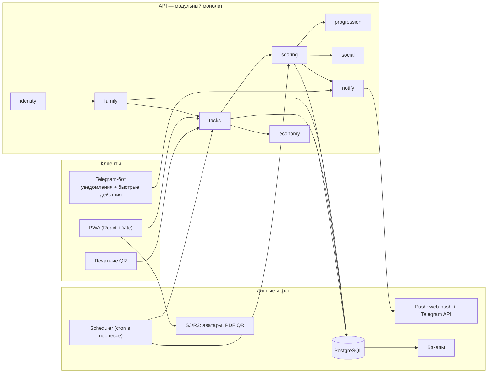
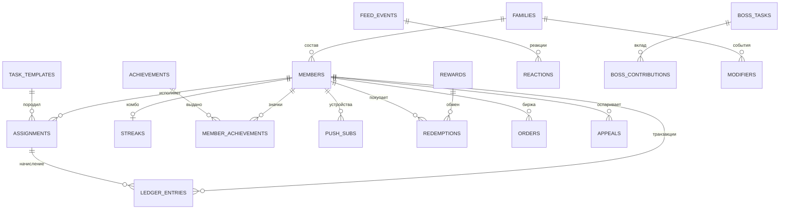

# FamilyQuest — критический разбор, архитектура, план

> Ответ на `IDEA.md`. Единица оценки: 1 dev-day ≈ 6–8 часов чистой работы (не «вечер с перерывами»).
> Календарные оценки даны для режима 10–12 часов в неделю.

---

## 0. Короткий вердикт

Идея хорошая, но в текущем виде это **не одно приложение, а четыре продукта в одном**: таск-трекер, экономика с валютой, RPG-прогрессия и соцсеть с лентой. Механик в файле — больше тридцати; вместе это 40–50 dev-days, то есть 5–8 месяцев по вечерам. Проект такого размера почти всегда умирает на третьем месяце не из-за сложности кода, а из-за стоимости владения.

Три вещи убьют его первыми, если не решить их до первой строки кода:

1. **Превращение домашних дел в «работу за деньги».** Внешняя награда вытесняет внутреннюю мотивацию (эффект сверхоправдания). Если «помыть посуду» всегда стоит 15 монет, то через месяц посуда без монет не моется вообще — и это хуже, чем было до приложения.
2. **Штрафы плюс роль судьи у родителя.** Каждое начисление превращается в семейный спор, где родитель — прокурор, судья и налоговая. Кнопка «Апелляция» из п.6 это не лечит, а узаконивает конфликт.
3. **Одобрение руками.** Если цикл «сделал → увидел очки» длиннее 10 минут, геймификация не работает. Родитель, который забыл одобрить вчерашнюю уборку, лично ломает игру.

Ядро, которое нужно сделать в первую очередь: **три тапа — выполнил, увидел начисление, увидел прогресс**. Всё остальное наращивается потом, потому что механики независимы.

---

## 1. Критический анализ

### 1.1 Сильные стороны

| Сильная сторона | Почему это важно |
|---|---|
| Высокая частота использования | Бытовые задачи ежедневны → привычка формируется за 2 недели, а не за 2 месяца |
| Есть живая аудитория 4–7 человек | Настоящие пользователи в одной квартире, обратная связь за минуты, не нужен маркетинг |
| Реальная боль, а не выдуманная | «Я один всё тащу» — типичная претензия в домохозяйстве; лента делает вклад видимым |
| Механики слабо связаны | Можно выпускать по фиче, не переделывая ядро |
| Идеальные условия для pet-project | Полный контроль требований, никаких заказчиков, можно выбросить фичу без последствий |
| Общий банк и кооп-задачи | Это единственные механики, которые уводят от «я зарабатываю на семье» к «мы вместе» — их стоит ценить выше личных рейтингов |

### 1.2 Главные риски

**Риск 1. Транзакционная мотивация (главный).** Классическая ловушка родительских «систем баллов». Когда за мытьё посуды платят, посуда превращается в работу, а работа без оплаты — в несправедливость. Дети начинают торговаться: «а сколько за это?», «а если я не буду — что?». Приложение усиливает эффект, потому что делает «цену» явной и постоянной.

*Контрмеры:*
- Разделить **долг** (обязательное, бесплатное: своя комната, своя посуда, уроки) и **квест** (то, что оплачивается: мытьё посуды за всю семью, помощь другим). Долг живёт в списке без монет, квест — в «доске приключений». Это ~20 строк кода и полностью меняет смысл.
- Награды — не деньги, а **доступ и статус** (выбор фильма, право не мыть посуду, скины на аватар, титул). Деньги в замкнутой системе всегда ощущаются как зарплата.
- Периодически добавлять **бесплатные сюрпризы** от системы (не за заслуги), чтобы модель «я получаю за вклад» не стала единственной.

**Риск 2. Штрафы.** Убытки переживаются примерно вдвое сильнее, чем эквивалентные приобретения. Штраф за просрочку бьёт по мотивации даже при «потолке 0 баллов»: сам факт списания демотивирует, а не сумма. Плюс штраф всегда кто-то выписывает — значит, есть виноватый и есть судья.

*Контрмеры:*
- **По умолчанию штрафов нет.** Есть только «награда не начислена» + сгорание комбо. Это уже чувствительно.
- Мягкий режим (включается админом): штраф ≤20% веса задачи, только в монетах, только за ежедневные задачи, не чаще 3 раз в месяц на человека, с обязательной причиной из выпадающего списка (а не свободным текстом).
- **Уровень (XP) никогда не уменьшается.** Это убирает «деградацию» — психологически худший опыт в любой RPG.

**Риск 3. Лидерборд с постоянным проигравшим.** В семье способности объективно разные: младший ребёнок всегда будет последним. Общий рейтинг «кто больше заработал» мотивирует одного и демотивирует троих.

*Контрмеры:*
- По умолчанию показывать **свой прогресс**, а не место в общем списке. Общий рейтинг — по **проценту выполнения личного плана**, а не по абсолютным баллам.
- Никогда не подсвечивать последнего, не вводить «красную зону».
- Раз в неделю — **командный показатель** («семья закрыла 78% дел»), а не личный.

**Риск 4. Одобрение как узкое горлышко и как роль судьи.** Каждая задача с ручным подтверждением — это отложенный дофамин и потенциальный спор.

*Контрмеры:*
- Политика на задачу: `auto` (по умолчанию для бытовых и повторяющихся), `review` (только для важных/дорогих), `qr` (для тех, где важно место).
- **Пост-модерация** вместо пре-модерации: баллы начисляются сразу, админ может отменить в течение суток. Игра не останавливается из-за занятого родителя.
- Доверие растёт: 10 подтверждённых выполнений подряд → задача переходит в `auto` автоматически.
- Массовые операции: «одобрить всё за сегодня», «одобрить неделю» одной кнопкой.

**Риск 5. Стоимость владения.** Это главный неочевидный риск. Приложение должно быть таким, чтобы родитель-админ тратил на обслуживание **менее 5 минут в неделю**, иначе им перестанут пользоваться, а автор (ты) — перестанет его поддерживать. Отсюда: шаблоны задач, автогенерация ежедневных, «повторить прошлую неделю», импорт/экспорт, а не ручное создание 30 задач.

**Риск 6. Судья играет за одну из команд.** Родитель создаёт задачи, устанавливает веса и одобряет выполнение — то есть одновременно игрок и арбитр. Дети это замечают быстро. Контрмера: веса берутся из **каталога задач** (одинаковые для всех), изменение веса задачи требует причины и логируется, а спорные кейсы решает правило, а не человек.

**Риск 7. Эксплойты.** Дети находят дыры за неделю: создать задачу самому себе через биржу и выполнить, дублировать выполнения, фармить комбо на пустых задачах, ставить награды самому себе.

*Контрмеры (обязательны к учёту в схеме БД):* нельзя быть исполнителем собственной задачи; биржа не даёт XP, только перевод монет (эскроу); идемпотентность каждого начисления; запрет повторного выполнения одной задачи в один день; лимит наград в неделю; полный audit log.

**Риск 8. Ожидания от PWA не сойдутся.** «Виджеты для смартфона» из п.6 в PWA не делаются (это нативная разработка). Push на iOS работают только с 16.4+ и только для установленного на домашний экран приложения. Если строить ожидания на «как нативное приложение», будет разочарование.

*Контрмеры:* см. §3.4 — Telegram-бот как основной канал уведомлений и быстрых действий. Это не компромисс, а лучший вариант для семейного приложения.

### 1.3 Что именно демотивирует и чем лечить

| Механика из IDEA.md | Почему бьёт | Контрмера |
|---|---|---|
| Комбо до x2.0 и сброс при пропуске | Потеря 30-дневного множителя из-за одного вечера — это наказание за жизнь (заболел, был в гостях) | Заморозка комбо (1–2 в месяц), сброс не в 1.0, а до x1.0 плавно (шаг −0.1 в день), комбо считается по неделям, а не по идеальной серии |
| «Герой Ноября» при 100% задач | Недостижимо → не пытаются вообще. Цель должна быть амбициозной, но реальной | Уровни: ≥95% — золото, ≥85% — серебро, ≥70% — бронза. Награда у всех трёх |
| Возрастной множитель на баллы | «Мне за то же платят меньше/больше» — прямая почва для обиды; взрослый видит, что ребёнок получает столько же монет за меньшую работу | Множитель действует только на **XP/звание** (там он воспринимается как гандикап, как в спорте), но **не на монеты**. Монеты = равная оплата за равную работу |
| Штраф + апелляция | Превращает семью в суд, а родителя — в обвинителя | Штрафы выключены по умолчанию, аппеляция заменена на «пост-модерацию в течение суток» и журнал изменений |
| Случайные дебаффы («штраф за посуду x2») | Случайность бьёт по восприятию справедливости; плохо предсказуемо для ребёнка | Баффы — только заблаговременно объявленные админом («выходные двойных баллов»), никогда не случайные и не ухудшающие |
| Публичный рейтинг | Постоянный проигравший | См. риск 3 |
| «Иммунитет 3 в месяц» | Хорошая идея, но если тратится автоматически — не ощущается | Явная кнопка «Пропустить задачу» с расходом токена, с анимацией и записью в ленту («Мама взяла выходной») |
| Огромный список задач на экране | Когнитивная перегрузка, особенно у младших | Экран «Сегодня»: максимум 5–7 карточек, остальное — во вкладке |

### 1.4 Что критично, что лишнее

**Must (без этого продукта нет):** роли и члены семьи, задачи с повтором, выполнение + одобрение, журнал баллов, уровни с прогресс-баром, лента активности, нормальный мобильный UX, тёмная тема (не за баллы, а сразу).

**Should (v1.1–1.2, даёт удержание):** комбо с заморозкой, значки-достижения, каталог призов и обмен, месячные звания, дашборд-статистика, push/Telegram-уведомления, «пропустить задачу» (токены), дедлайны с напоминанием за час.

**Later (v1.3+, работает только на уже приученной семье):** биржа заказов, «семейный босс», баффы, семейный банк, наставничество, челленджи, темы за баллы, кастомизация аватаров, сезонные события.

**Cut / переосмыслить:**
- **NFC-метки** — поддержка только Android, наклейка отклеивается. Заменить на QR: печатается PDF-лист с QR, клеится на ведро/машинку, сканирование открывает экран задачи. Цена — 1 dev-day, ценность та же.
- **Нативные виджеты** — нереализуемо в PWA. Заменить: ярлык на домашнем экране + Telegram-бот с кнопкой «Мои задачи» + утренний дайджест.
- **QR-автозавершение без одобрения** — доказывает место, а не факт выполнения, и провоцирует «отсканировал и ушёл». Только «быстрый лог» с одобрением.
- **Оценка «всё сделано в срок» как единственный критерий месячного звания** — недостижимо, заменяется процентами.
- **Возрастной множитель на валюту** — переносится на XP.
- **Ручное создание ежедневных задач** — только шаблоны + автогенерация.

### 1.5 Шесть решений, которые нужно зафиксировать до кода

1. **Две величины вместо одной.** `XP` (опыт: только растёт, определяет уровень) и `coins` (монеты: тратятся, могут уменьшаться, не ниже 0). Одна величина не может одновременно быть «прогрессом» и «деньгами» — это источник половины проблем в подобных проектах.
2. **Баллы — это журнал транзакций, а не поле в таблице.** Баланс = `SUM(amount)`. Иначе через месяц ты не сможешь ответить на вопрос «почему у Маши 137?» — а этот вопрос будет задан.
3. **Правила начисления — чистые функции с тестами, и версия правил сохраняется** в каждой транзакции. Спор «почему 37, а не 40» решается ссылкой на правило v3.
4. **Календарь — в часовом поясе семьи, хранение — в UTC.** «Сегодня» для дедлайна определяется `families.timezone`, иначе задачи закрываются не в полночь.
5. **Начисление идемпотентно.** У каждой транзакции есть `idempotency_key`; двойной тап по кнопке не должен давать двойные баллы.
6. **Никакой случайности, влияющей на чужой результат.** Всё, что меняет коэффициенты, объявляется заранее и видно в интерфейсе.

---

## 2. Архитектура

### 2.1 Принцип

**Модульный монолит.** 5–10 пользователей на инсталляцию, пиковая нагрузка — «вся семья вечером одновременно». Микросервисы, Kubernetes, Redis в качестве обязательного слоя, GraphQL, event bus — всё это здесь чистый убыток: ты будешь чинить инфраструктуру вместо фич.

Границы модулей проводим по **доменам**, а не по слоям, чтобы потом можно было вынести что угодно в отдельный процесс без переписывания (например, планировщик).

```
presentation (REST/SSE)  →  application (use cases)  →  domain (чистые правила)  →  infra (репозитории)
```

Правило: `domain` не импортирует ничего из БД, HTTP и фреймворков. Именно там живут формулы начисления, расчёт комбо, порогов уровней и проверки достижений — и именно это покрывается юнит-тестами, потому что это единственная часть, которую нельзя проверить глазами.

### 2.2 Схема



### 2.3 Модули

| Модуль | Ответственность | Ключевые сущности | Не делает |
|---|---|---|---|
| `identity` | вход, сессии, пароли/PIN, приглашения | users, sessions | не знает про задачи |
| `family` | состав, роли, часовой пояс, настройки | families, members, settings | не начисляет баллы |
| `tasks` | шаблоны, повторяемость, экземпляры задач, статусы, одобрение | task_templates, assignments, approvals | не считает очки |
| `scoring` | формулы, журнал транзакций, балансы, модификаторы | ledger_entries, modifiers | не решает, что такое уровень |
| `progression` | уровни, комбо, значки, месячные звания | levels, streaks, achievements | не двигает деньги |
| `economy` | призы, обмен, биржа заказов, семейный банк | rewards, redemptions, orders, escrow | не начисляет за выполнение |
| `social` | лента, реакции, кооп-задачи | feed_events, reactions, boss_tasks | не считает баллы |
| `notify` | планирование и отправка уведомлений | notifications, push_subs | не принимает решений |
| `reporting` | агрегаты для дашборда (только чтение) | views | не пишет в домен |
| `integrations` | QR-токены, Telegram, экспорт .ics | qr_tokens | — |

### 2.4 Три главных сценария

**Выполнение задачи.** Клиент `POST /assignments/{id}/complete` с `Idempotency-Key` → `tasks` проверяет статус и право (`assignee`, не позже чем через 24 ч после дедлайна) → создаёт `submission` → по политике: `auto` → сразу `Approve`; `review` → ждёт админа → use case `Approve` → `scoring.award(assignment)` → чистые функции считают `coins` и `xp` → запись в журнал (с `rule_version`) → `progression.recompute(user)` (уровень, комбо, значки) → `social.emit(feed)` → `notify.push("+15 🪙")`. Всё это в одной транзакции БД.

**Дедлайн.** Раз в 5 минут (`tasks.closeOverdue`): выбрать задания, где `due_at < now()` и статус `pending` → `missed` (или `late`-окно 24 ч) → если монеты за просрочку не начисляются → `progression.breakCombo` (или заморозка) → если штрафы включены — `scoring.penalize` → запись в ленту.

**Полночь семьи.** `families.timezone` → 00:05: `tasks.materializeDaily` (создать экземпляры из шаблонов на сегодня, проверив, что не созданы) → `progression.rollStreaks` → 1-го числа: `progression.monthlyAwards`, сброс токенов иммунитета → уведомления.

### 2.5 Фоновые задания

| Задача | Расписание | Идемпотентность |
|---|---|---|
| Материализация ежедневных/еженедельных | 00:05 по TZ семьи | уникальный индекс (template_id, date) |
| Закрытие просрочек | каждые 5 минут | статус-переход `pending→missed` |
| Напоминание за час до дедлайна | каждые 5 минут | `notifications` unique(user, kind, ref) |
| Истечение баффов | ежечасно | `ends_at` |
| Месячные итоги | 1-е число 00:30 | `(member_id, period)` unique |
| Недельный дайджест | вс 19:00 | `(member_id, week)` unique |
| Повтор push-уведомлений | раз в 10 минут | счётчик попыток |

Реализация — `node-cron` внутри API-процесса на старте. Отдельный воркер появится только если планировщик начнёт мешать запросам — до этого он не нужен.

### 2.6 Обновления в реальном времени

Лента и «кто что сделал» — через **SSE** (`GET /events`), односторонний поток, без библиотек, переживает прокси. WebSocket не нужен: двусторонняя связь здесь не требуется. Оффлайн-клиент после переподключения догоняет через `GET /feed?after=cursor`.

### 2.7 Оффлайн и «слабая связь»

Мобильный сценарий: ребёнок в подвале/на улице. Поэтому:
- PWA с service worker: оболочка из кэша, `stale-while-revalidate` для списка задач;
- мутации при offlaine кладутся в IndexedDB и отправляются при появлении сети, **с заранее сгенерированным `Idempotency-Key`** — это ключевая деталь, без неё оффлайн-очередь создаёт дубли;
- индикатор «нет связи, 2 действия в очереди».

### 2.8 API (REST, OpenAPI генерируется из схем Zod)

```
POST   /auth/login                          вход
GET    /me                                  профиль + балансы + уровень
GET    /members                             семья + прогресс участников
GET    /assignments?date=today&status=open  мои задачи
POST   /assignments/:id/complete            выполнил
POST   /assignments/:id/approve | /reject   админ
POST   /assignments/:id/skip                потратить токен иммунитета
POST   /assignments/:id/waive               админ: простить
GET    /templates  POST /templates  PATCH   CRUD шаблонов + «повторить неделю»
GET    /ledger?user=                        история начислений
GET    /progress/:memberId                  уровень, комбо, значки
GET    /rewards  POST /rewards/:id/redeem   каталог и обмен
GET    /feed  POST /feed/:id/react          лента и реакции
GET    /stats?range=month                   дашборд
POST   /integrations/qr/:token              быстрый лог по QR
GET    /events                              SSE
```

---

## 3. Стек

### 3.1 Рекомендация (вариант A — «свой стек»)

| Слой | Выбор | Обоснование |
|---|---|---|
| Frontend | **React 19 + TypeScript + Vite 6** | нет нужды в SSR; Vite даёт мгновенную сборку и простой PWA-плагин |
| UI | **Tailwind 4 + shadcn/ui** | крупные тапабельные элементы настраиваются за минуты, никакой борьбы с дизайн-системой |
| Данные | **TanStack Query 5 + TanStack Router** | кэш, оптимистичные обновления (очки появляются мгновенно), типизированные маршруты |
| PWA | **vite-plugin-pwa (Workbox)** | манифест, precache, оффлайн-очередь |
| Графики | **Recharts** | дашборд без изучения D3 |
| Backend | **Node.js 22 + TypeScript + Fastify 5** | схема-first, быстрый, Zod из коробки; NestJS — если хочется жёсткой структуры на много модулей, но для 10 модулей это лишние 20% кода |
| Валидация | **Zod** | одна схема → валидация запроса + типы клиента + OpenAPI |
| ORM | **Drizzle** | SQL остаётся видимым, миграции — файлами, никакой магии; Prisma тоже ок |
| БД | **PostgreSQL 16** | транзакции, `timestamptz`, оконные функции для статистики, `jsonb` для правил |
| Файлы | **S3-совместимое (Cloudflare R2, free tier)** | аватары и PDF с QR; диск в контейнере теряется при переезде |
| Уведомления | **web-push (VAPID) + Telegram Bot API** | Telegram — основной канал: работает на всех телефонах, кнопки одобрения прямо в чате |
| Auth | **cookie-сессии (httpOnly) + argon2**, для родителей опционально WebAuthn | проще и безопаснее JWT в localStorage; детям — вход по PIN/выбору аватара |
| Тесты | **Vitest** (домен), **Playwright** (2–3 e2e сценария) | 80% усилий — в тесты формул, остальное руками |

**Почему не Next.js:** для приватного приложения на 7 пользователей не нужны SSR, RSC и серверные экшены; ты получаешь сложность деплоя и кэширования без выгоды. SPA + API — самый короткий путь.
**Почему не Supabase как основа (хотя это рабочий вариант):** RLS для «баллы начисляются только админом и только по правилам» быстро упирается в необходимость серверной логики; формулы и фоновые задачи всё равно уедут в edge-функции, и ты получишь два места правды.

### 3.2 Вариант B — «минимум операций» (если цель — не изучать бэкенд)

**Supabase** (Auth + Postgres + RLS + Realtime + Storage) + SPA на React/Vite + Edge Functions для планировщика (`pg_cron`) и начислений. Быстрее на 1–2 недели, дешевле в обслуживании, но логику начисления придётся держать в SQL/функциях Postgres — тестировать её менее приятно. Подходит, если приоритет — «работает у семьи как можно скорее».

### 3.3 Деплой

```
Один VPS 2 vCPU / 4 GB (Hetzner CX22, ~€4/мес)
└── docker compose
    ├── caddy         (TLS автоматически, reverse proxy, gzip)
    ├── api           (Node, 512 MB, restarts)
    ├── postgres:16   (том на диске)
    └── backup        (pg_dump → R2, ежедневно, хранить 30 дней)
```

- Домен + Cloudflare (бесплатно, кэш статики, защита от ботов).
- Статика фронта — отдаётся Caddy из `dist` или с Cloudflare Pages (тогда VPS только для API).
- **Обязательно:** ежедневный бэкап и **раз в месяц проверенное восстановление**. Приложение семейное, потеря истории за год — это конец проекта.
- Итого: **€5–8 в месяц**. Это единственная разумная альтернатива бесплатному хостингу (Railway/Fly free tier засыпает, а сон API ломает push и cron).

### 3.4 PWA: что реально получится

| Хотелка из IDEA.md | Реальность | Решение |
|---|---|---|
| Добавить на домашний экран | Да, везде | `manifest` + `display: standalone` + safe-area |
| Push-уведомления | iOS — только 16.4+ и только установленное PWA; Android — да | Основной канал — Telegram-бот, web-push — вторичный |
| Доступ к камере (QR) | Да, `getUserMedia` + `BarcodeDetector` (Safari 17+) | Фолбэк: поле для кода вручную |
| Виджеты на рабочий стол | **Нет** в PWA | Telegram-бот: «Мои задачи» одним сообщением + утренний дайджест 8:00 |
| Работа оффлайн | Частично | Кэш оболочки + очередь мутаций (см. §2.7) |
| Тёмная тема | Да, но за баллы — плохая идея | Тёмная тема сразу и бесплатно; за баллы — **скины** (фоны, рамки, аватары), это и есть кастомизация |

**Telegram-бот — недооценённая киллер-фича.** Инлайн-кнопки «Выполнил», «Одобрить», «Пропустить» прямо в чате; напоминание за час; воскресный дайджест. Это ~2 dev-day и оно заменяет и виджеты, и половину уведомлений, и «быстрый лог». Семья живёт в мессенджере, а не в браузере.

---

## 4. Структура базы данных

### 4.1 ER (упрощённо)



### 4.2 Таблицы

```sql
families      (id, name, timezone, coin_name, xp_name, settings jsonb, created_at)
-- settings: {fines_enabled, combo_freeze_per_month, approval_policy_default, ...}

members       (id, family_id, role['admin'|'adult'|'child'], display_name, login,
               password_hash, pin_hash, birth_date, avatar_url, color,
               xp_total int, coins_balance int,   -- денормализация для быстрых экранов
               coins_floor int default 0, status, created_at, deleted_at)

push_subs     (id, member_id, endpoint, p256dh, auth, user_agent, created_at)

task_templates(id, family_id, title, description, category, kind['duty'|'quest'],
               base_weight int, recurrence['none'|'daily'|'weekly'|'monthly'],
               weekdays int[], due_time time, approval['auto'|'review'|'qr'],
               age_min, age_max, active, created_by, created_at)

assignments   (id, family_id, template_id, title, assignee_id, created_by,
               weight int, due_at timestamptz, status['pending'|'submitted'|'approved'|'rejected'|'missed'|'skipped'],
               approval, submitted_at, decided_at, decided_by, coins_awarded int,
               xp_awarded int, rule_version, source['template'|'manual'|'exchange'|'boss'],
               price_coins int,   -- для биржи
               note, created_at)
-- UNIQUE (template_id, assignee_id, date_trunc('day', due_at)) для daily

ledger_entries(id, family_id, member_id, coins int, xp int,
               kind['award'|'penalty'|'reward'|'exchange_in'|'exchange_out'|'bank'|'adjust'],
               ref_type, ref_id, note, rule_version,
               idempotency_key UNIQUE, created_by, created_at)
-- APPEND-ONLY: UPDATE/DELETE запрещены триггером

levels        (id, index, name, xp_threshold, reward_id)
streaks       (member_id PK, current int, best int, last_day date, freezes_left int, updated_at)
immunity      (id, member_id, period 'YYYY-MM', used_at, reason, assignment_id)

achievements  (id, family_id, code UNIQUE, title, description, hidden bool, icon, rule jsonb)
member_achievements(member_id, achievement_id, progress int, unlocked_at, PK(member_id, achievement_id))

rewards       (id, family_id, title, description, tier['micro'|'medium'|'global'],
               price_coins, stock, active, created_at)
redemptions   (id, member_id, reward_id, coins_spent, status['pending'|'approved'|'rejected'|'delivered'],
               decided_by, created_at)

orders        (id, family_id, creator_id, assignee_id, title, price_coins,
               status['open'|'taken'|'done'|'cancelled'|'expired'], escrow_id, deadline, created_at)
-- escrow_id ссылается на ledger_entries (списание у создателя при создании заказа)

modifiers     (id, family_id, kind['bonus'|'buff'], scope_category, factor numeric,
               starts_at, ends_at, created_by, note)

boss_tasks    (id, family_id, title, description, goal numeric, unit,
               deadline, bonus_xp, bonus_coins, status)
boss_contributions(boss_id, member_id, value numeric, approved, PK(boss_id, member_id))

feed_events   (id, family_id, kind, actor_id, subject_id, payload jsonb, created_at)
reactions     (feed_event_id, member_id, emoji, PK(feed_event_id, member_id, emoji))

appeals       (id, family_id, member_id, assignment_id, ledger_id, reason,
               status['open'|'accepted'|'rejected'], resolved_by, resolution, created_at)

notifications (id, member_id, kind, ref_type, ref_id, channel, scheduled_at,
               sent_at, attempts, status)
audit_log     (id, family_id, actor_id, action, entity, entity_id, before jsonb, after jsonb, created_at)
```

### 4.3 Инварианты (это важнее самих таблиц)

1. **Только целые числа баллов.** Никаких `float`/`numeric` в валюте — округление станет источником расхождений.
2. **`ledger_entries` неизменяем.** Отмена — обратная транзакция, а не `UPDATE`. Триггер `BEFORE UPDATE OR DELETE → RAISE`.
3. **Баланс — производная.** `members.coins_balance` — кэш для экрана; раз в сутки сверять `SUM(coins)` и чинить (джоб `reconcileBalances`), иначе дрейф неизбежен.
4. **`idempotency_key` unique** на каждом начислении (`assignment:{id}:award`, `redemption:{id}`).
5. **Всё время — `timestamptz` (UTC)**, «день» вычисляется в TZ семьи: `(due_at AT TIME ZONE f.timezone)::date`.
6. **`rule_version`** в каждой транзакции — позволяет объяснить любую сумму задним числом.
7. **Мягкое удаление** участников и шаблонов (`deleted_at`): история должна остаться.
8. **`source` в assignment** — защита от накрутки: за `exchange` XP не начисляется.

### 4.4 Индексы (минимум, который понадобится)

```sql
assignments (assignee_id, status, due_at)        -- «мои задачи»
assignments (family_id, due_at) WHERE status='pending'  -- просрочки
ledger_entries (member_id, created_at DESC)      -- история и баланс
feed_events (family_id, created_at DESC)         -- лента
notifications (status, scheduled_at) WHERE sent_at IS NULL
unique (template_id, assignee_id, (due_at AT TIME ZONE 'UTC')::date)
```

### 4.5 Миграции и сиды

Drizzle-миграции файлами в репозитории, применяются в контейнере при старте (`drizzle-kit migrate`). Сиды: каталог из 25–30 задач с весами и возрастами, 12 уровней, 10 значков, 8 призов — чтобы «пустое приложение» не встречало пользователя пустым экраном.

---

## 5. План реализации

Оценки — для разработчика, который знает стек. Если стек новый — умножай на 1.5–2.

### Этап 0. Подготовка (1–1.5 dev-day)
Схема БД §4, каркас монорепы (`apps/api`, `apps/web`, `packages/shared`), CI (typecheck + lint + тесты), docker-compose, домен, TLS. **DoD:** `docker compose up` поднимает пустое приложение по HTTPS.

### Этап 1. MVP — «работает в семье» (10–14 dev-day)
Роли и члены (вход по PIN + админ по паролю), CRUD шаблонов задач, ежедневные/со-сроком, экран «Сегодня», выполнение, одобрение (в т.ч. массовое), журнал баллов, XP и 12 уровней с прогресс-баром, лента активности, мобильная вёрстка, тёмная тема, деплой + бэкап. **DoD:** семья пользуется неделю без вмешательства в код.
*Календарно при 10–12 ч/нед: 7–9 недель.*

### Этап 2. Удержание (7–9 dev-day)
Комбо с заморозкой, токены «пропустить», значки (движок правил + 10 штук), дедлайны с напоминанием за час, web-push, Telegram-бот с кнопками. **DoD:** родитель не заходит в веб-интерфейс, чтобы одобрить.

### Этап 3. Экономика (8–10 dev-day)
Каталог призов, обмен с одобрением, семейный банк (общая цель с прогрессом), месячные звания по процентам, дашборд-статистика, недельный дайджест. **DoD:** в конце месяца есть автоматический отчёт и выданные призы.

### Этап 4. Соцсеть и кооп (10–12 dev-day)
Реакции, биржа заказов с эскроу (нельзя выполнять свою, нет XP), «семейный босс» с общим прогрессом, объявленные баффы, челленджи, скрытые значки. **DoD:** есть механика, заставляющая делать что-то вместе.

### Этап 5. Полировка (6–8 dev-day)
QR-лист для печати, оффлайн-очередь, «повторить неделю», скины за баллы, экспорт .ics, доступность (контраст, крупные шрифты), 3 e2e-теста, Sentry.

### Этап 6. Опционально (по желанию)
Апелляции со ведением истории, мультисемейность (нужен `family_id` уже в этапе 0 — заложить сразу, стоит 0), публичный шаринг достижений, сезонные события.

**Итого:** MVP ≈ 12–16 dev-days; полный набор ≈ 45–55 dev-days. Первые две недели после запуска почти всегда уходят на «а это не работает как мы думали» — заложи их.

### Что я бы выкинул из первой версии намеренно
Апелляции, баффы/дебаффы, случайные события, наставничество, темы за баллы, чаевые, NFC, виджеты. Не потому что плохо, а потому что каждое из них добавляет ветвление в модель данных и UI, а ценность в первый месяц почти нулевая.

---

## 6. Дополнительные предложения

### 6.1 Киллер-фичи по порядку внедрения
1. **Три тапа до начисления** (иконка → «Выполнил» → очки летят в прогресс-бар). Если это медленнее, всё остальное не спасёт.
2. **Telegram-бот с инлайн-кнопками.** Уведомление, одобрение, «мои задачи» — без открытия приложения.
3. **Пост-модерация вместо пре-модерации.** Очки сразу, отменить можно сутки.
4. **Комбо с заморозкой и «пропустить задачу».**
5. **Семейный босс** — единственная механика, которая переводит игру из конкуренции в кооперацию. «Покрасим забор вместе — все получат бонус».
6. **Воскресный дайджест** (картинка/сообщение: кто что сделал, семейный процент, топ-задача недели). Даёт смысл собирать данные.
7. **Годовой итог в стиле Spotify Wrapped** — «в 2026 году семья вынесла мусор 412 раз». Дёшево, эмоционально, делится.

### 6.2 UX/UI — конкретные правила
- Один главный экран = «Сегодня» с 5–7 карточками. Всё остальное — вкладки: Задачи / Призы / Лента / Семья.
- Тапабельные зоны ≥ 44×44 px; шрифт интерфейса ≥ 16 px; никакого текста мельче 12 px в бейджах.
- **Никакого красного для долгов и просрочек.** Красный = опасность = тревога = избегание. Используй нейтрально-серый и «мягкий» акцент. Наказание не должно быть визуально громким.
- Цвет аватара/акцента закреплён за человеком (у каждого свой) — узнаваемость за 0.2 секунды.
- Прогресс-бар с анимацией переполнения при повышении уровня + конфетти (1 из 3 раз, а не каждый — иначе приедается).
- Скелетоны вместо спиннеров, оптимистичные обновления вместо «подожди».
- Пустые состояния с характером («Здесь пока пусто. Возьми первую задачу — мусорное ведро само себя не вынесет»).
- «Детский режим»: скрыть экономику, оставить «сегодня + прогресс + значки»; крупнее, ярче, минимум текста.
- Админ-режим отдельным переключателем, чтобы случайно не одобрить чужое.

### 6.3 Антипаттерны, которые убивают такие проекты
- Ручное обслуживание: создание задач каждую неделю руками → через месяц забросят.
- Больше 5 уровней настройки на каждую награду.
- Уведомления без пользы («проверь приложение!») → отключают все, включая нужные.
- Публичный рейтинг в первый же день.
- Обсуждение правил в чате вместо фиксации их в коде.
- Усложнение ради демонстрации (микросервисы «для опыта»).

### 6.4 Метрики успеха (чтобы понять, работает ли)
- % ежедневных задач, закрытых без напоминания (цель > 60%)
- медиана времени от «выполнил» до «начислено» (цель < 2 минут)
- % дней с хотя бы одним действием на члена семьи (цель > 50% за первую неделю, > 30% к третьему месяцу)
- число споров/правок задним числом в месяц (должно падать)
- «неделя без захода в админку» — главный признак, что продукт живой

---

## 7. Масштабирование и интеграции

### 7.1 Техническое масштабирование (если решишь сделать SaaS)
- `family_id` с первого дня (уже в схеме) → изоляция слоем запросов или RLS, стоит ноль сейчас и очень дорого потом.
- Шардирование не понадобится никогда при таком профиле нагрузки; узкое место — планировщик, он выносится в отдельный процесс первым.
- Мультитенантность → подписка, лимиты, отдельный бакет на семью, GDPR-страница (детские данные — аккуратно: никакой внешней аналитики, только self-hosted Umami/Plausible).

### 7.2 Внешние интеграции (в порядке полезности)
| Интеграция | Зачем |
|---|---|
| **Telegram Bot** | уведомления, одобрение, «мои задачи» — выполнять первым |
| **Google/Apple календарь (.ics)** | задачи с дедлайном видны в календаре; экспорт, а не OAuth (проще) |
| **Home Assistant / MQTT** | «посудомойка закончила» → автозадание; самый «вау» для семьи с умным домом |
| **Яндекс.Погода / OpenWeather** | «на улице дождь» → задача «полить огород» скрывается; буст реализма |
| **Голосовой ввод (Web Speech)** | планирование в духе «Создай задачу: вынести мусор завтра в 8» |
| **Камера + QR** | быстрый лог у места |
| **Экспорт в CSV/Notion** | удержание истории, если проект закроется |

### 7.3 Если проект станет продуктом
Сначала — 5 знакомых семей, ручной онбординг, еженедельный созвон. Универсальные «настройки под любую семью» появляются только после третьего запроса на одно и то же. Монетизация — подписка на семью, а не на человека; никакой рекламы.

---

## 8. Приложения

### 8.1 Формулы (базовая версия)

```
coins = round(base_weight × M_event)                  только если выполнено в срок
xp    = round(coins × A_age × M_combo)                 всегда, когда начислены coins

A_age (гандикап, только XP):  <8 → 1.8   8–10 → 1.6   11–13 → 1.4   14–17 → 1.2   18+ → 1.0
M_combo = 1.0 + 0.1 × floor(min(streak, 30) / 3)       максимум ×2.0 на 30 днях
M_event = объявленный множитель (1.0 / 1.5 / 2.0), только на выбранную категорию

Уровень = max(levels.index) WHERE xp_total >= xp_threshold
Пороги (кумулятивно): 0, 100, 250, 450, 700, 1000, 1400, 1900, 2500, 3200, 4000, 5000
Названия: Новичок, Ученик, Подмастерье, Хозяин, Мастер, Магистр, Хранитель Очага,
          Сенешаль, Властелин Пыли, Сэр Чистые Руки, Легенда очага, Легенда семьи

Месячное звание (по проценту выполнения личного плана):
  ≥95% и нет просрочек → «Герой месяца» (золото)
  ≥85%                → «Хранитель месяца» (серебро)
  ≥70%                → «Стойкий» (бронза)
```

Пример: «Вынести мусор», вес 10, комбо 21 день (×1.7), ребёнку 12 лет (A=1.4):
`coins = 10`, `xp = round(10 × 1.4 × 1.7) = 24`.

### 8.2 Стартовый каталог задач (сид)

| Задача | Вес | Тип | Возраст | Одобрение |
|---|---|---|---|---|
| Своя комната | 0 | долг | 6+ | auto |
| Своя посуда | 0 | долг | 6+ | auto |
| Домашнее задание | 0 | долг | 7+ | review |
| Вынести мусор | 10 | квест | 7+ | auto |
| Помыть посуду за всех | 15 | квест | 10+ | auto |
| Прибрать ванную | 20 | квест | 12+ | review |
| Приготовить ужин | 30 | квест | 14+ | review |
| Постирать и развесить | 25 | квест | 12+ | auto |
| Погулять с собакой | 12 | квест | 8+ | auto |
| Почистить лоток | 10 | квест | 8+ | auto |
| Прочитать 30 страниц | 15 | квест | 7+ | review |
| Зарядка 15 минут | 8 | квест | 6+ | auto |
| 10 слов на английском | 10 | квест | 8+ | review |
| Сходить в магазин | 25 | квест | 12+ | review |
| Помочь с уроками младшему | 20 | квест | 12+ | review |
| Организовать настольную игру | 25 | квест | 10+ | auto |
| Прибрать на лестнице | 20 | квест | 12+ | review |
| Оплатить квитанции | 30 | квест | 18+ | auto |
| Записаться к врачу | 15 | квест | 18+ | auto |
| Генеральная уборка (босс) | — | босс | все | review |

### 8.3 Чек-лист запуска в семье
1. Объявить правила вслух **и** разместить их на экране «Правила»: что долг, что квест, сколько стоит, что бывает за просрочку (или что её просто нет).
2. Первый месяц — без штрафов вообще. Наказания вводятся, когда игра уже нравится.
3. Сказать прямо: баллы не деньги, это «спасибо, которое можно потратить на приз».
4. Первую неделю — общий рейтинг выключен, только личный прогресс.
5. Выдавать призы **всерьёз и вовремя**. Обещанный и не выданный приз убивает доверие к системе навсегда.
6. Каждое воскресенье — 5 минут на дайджест всей семьёй.

### 8.4 Анти-эксплойт чек-лист (перенести в тесты)
- нельзя выполнить задачу, где ты `created_by` (кроме `source='template'`);
- за `source='exchange'` XP не начисляется никогда;
- `UNIQUE(assignment_id)` в ledger против двойного начисления;
- «один раз в день» для daily-шаблонов — уникальный индекс, а не проверка в коде;
- списание монет на биржу — атомарно, через эскроу;
- лимит: не более N наград в неделю на человека (настраиваемо);
- любое изменение веса/статуса задним числом → `audit_log` + запись в ленту.

### 8.5 Что я считаю главной ошибкой исходной идеи
Стремление сделать всё сразу и «по-настоящему как в игре». Реальная семья проверяет приложение на третьем-четвёртом дне: если к этому моменту половина фич не работает или требует настроек, доверие кончится. **Правильный путь — три механики, работающие безотказно, чем тридцать, работающих в теории.**
